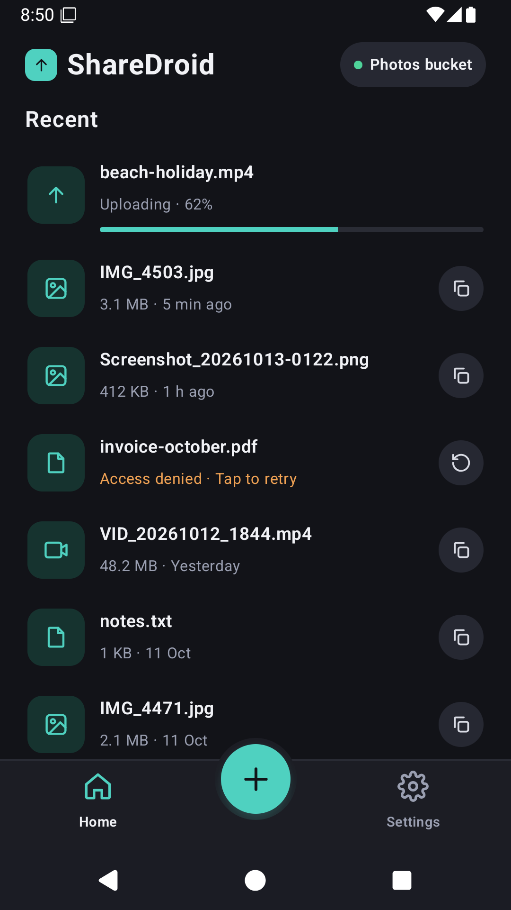
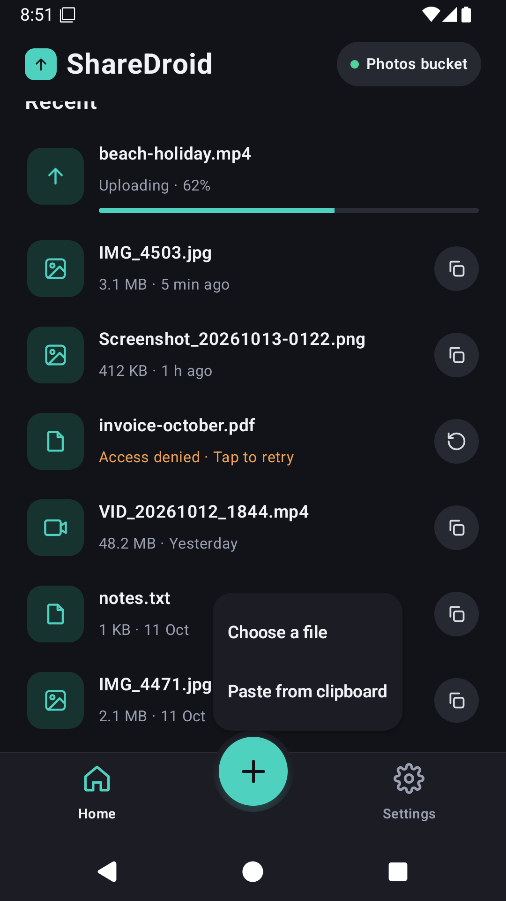
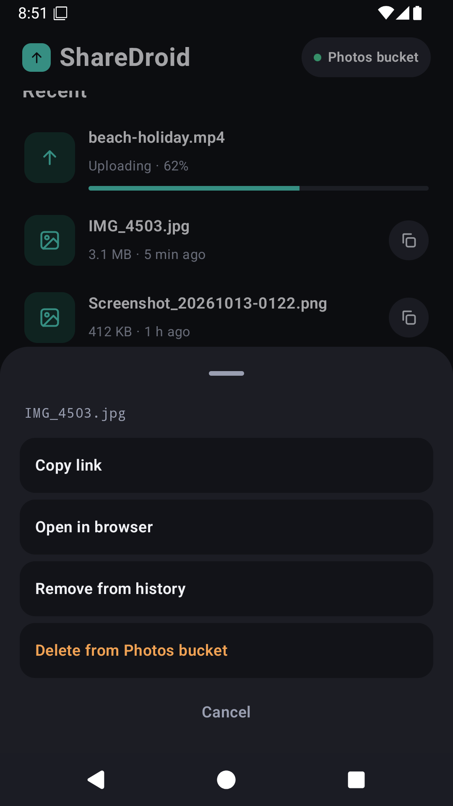
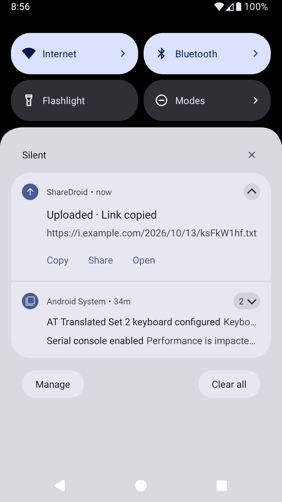
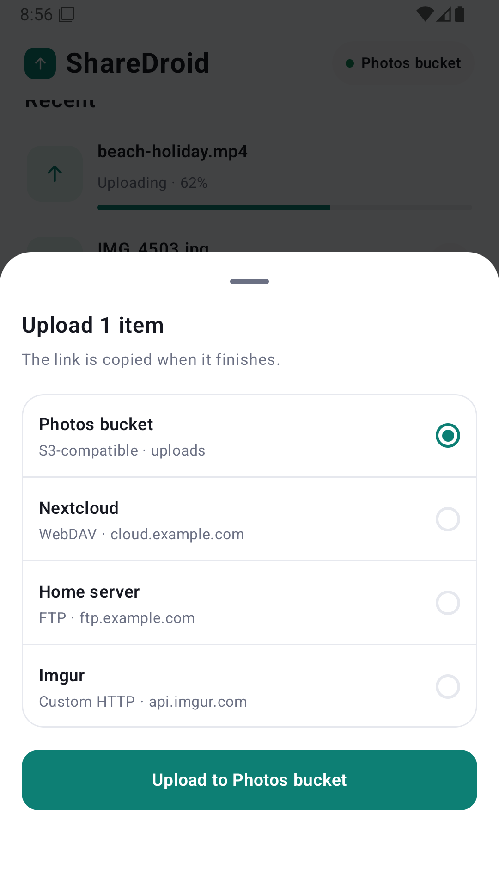
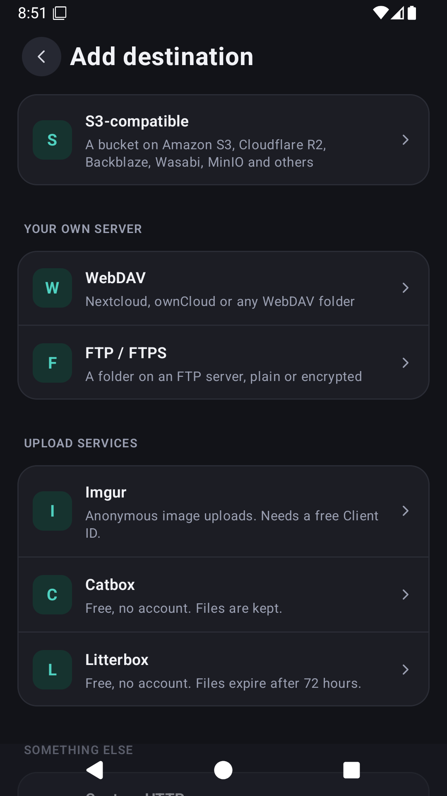
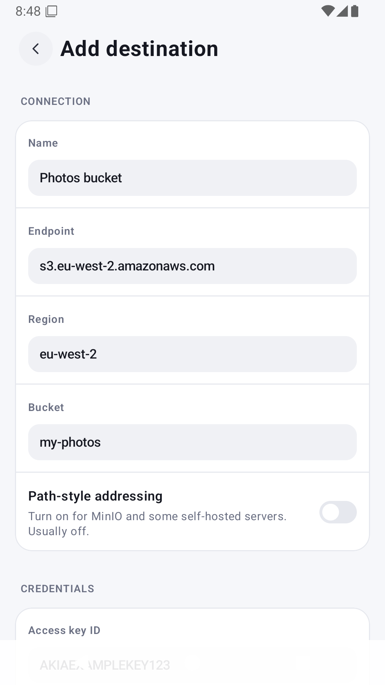
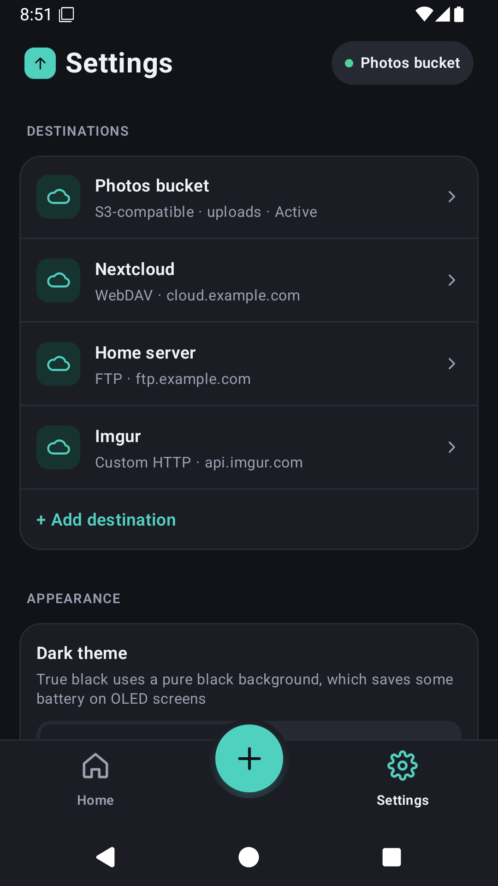

# ShareDroid

ShareX-style uploads for Android. Share a photo, video or file from any app, and ShareDroid uploads it to a destination you configure and puts the link on your clipboard.

No servers, accounts, analytics or ads. Your credentials are encrypted on the device and files go only to the destination you choose. Free software under the GPL-3.0.

<p>
  
  
  
  
</p>
<p>
  
  
  
  
</p>

## Features

- **Share from any app**, or tap **+** in ShareDroid for the photo picker, and press and hold it for a file or the clipboard.
- **Background uploads** with progress, a result notification (Copy, Share, Open) and retry. Android 14 and later use user-initiated data transfer jobs.
- **History** of recent uploads, with copy, open, retry, remove, and delete from the destination.
- **Destinations**
  - **S3-compatible** storage: Amazon S3, Cloudflare R2, Backblaze B2, Wasabi, MinIO and others. Public or expiring links.
  - **WebDAV**: Nextcloud, ownCloud and any WebDAV folder.
  - **FTP and FTPS** (explicit and implicit).
  - **Custom HTTP**: POST or PUT to any URL as a form or raw body, with the link read from the reply. Modelled on ShareX custom uploaders, with presets for Imgur, Catbox and Litterbox.
- **File names** built from tokens such as `{yyyy}/{MM}/{random:8}.{ext}`, with a live preview.
- **Location removed** from JPEG photos before upload, on by default.
- **Appearance**: accent colours or your wallpaper's, dark and true black, and a custom Home title.

Requires Android 12 or later.

## Install

Signed APKs are attached to each [release](https://github.com/aaronburt/sharedroid/releases). Check the `.sha256` file next to the APK if you like.

## Building

Requires JDK 17+ and the Android SDK.

```sh
./gradlew :app:assembleDebug                                   # debug APK
./gradlew :s3:test :http:test :ftp:test :app:testDebugUnitTest # all unit tests
./gradlew :app:lintDebug                                       # Android lint
```

Debug builds allow plain `http://` so a local test server, such as MinIO, is reachable from the emulator at `http://10.0.2.2:9000`. Release builds only allow `https://`.

### Modules

| Module | What it is |
|---|---|
| `app` | The Android app (Kotlin, Jetpack Compose). Package `uk.co.aaronburt.sharedroid` |
| `s3` | Plain Kotlin/JVM S3 client: SigV4 signing, key templates, uploads, expiring links |
| `http` | Plain Kotlin/JVM custom HTTP uploader, the WebDAV client and the upload-service presets |
| `ftp` | Plain Kotlin/JVM FTP and FTPS client, built on Apache Commons Net |

## Releasing

Pushing a version tag builds and publishes a release:

```sh
# set versionName (and bump versionCode) in app/build.gradle.kts, update CHANGELOG.md, commit, then:
git tag v0.2.0
git push origin v0.2.0
```

The [release workflow](.github/workflows/release.yml) checks the tag matches `versionName`, runs the tests, builds the release APK and attaches it, with a checksum and the changelog notes, to the GitHub release.

### Signing

Without a signing key the workflow still runs but publishes an **unsigned** APK, which Android will not install. To publish signed APKs, create a keystore once and keep it safe: **if you lose it you cannot update installed copies of the app**.

```sh
keytool -genkeypair -v -keystore sharedroid-release.jks -alias sharedroid \
  -keyalg RSA -keysize 4096 -validity 10000
base64 -w0 sharedroid-release.jks   # on macOS: base64 -i sharedroid-release.jks
```

Then add these **repository secrets** (Settings > Secrets and variables > Actions):

| Secret | Value |
|---|---|
| `SIGNING_KEYSTORE_BASE64` | the base64 output above |
| `SIGNING_KEYSTORE_PASSWORD` | the keystore password |
| `SIGNING_KEY_ALIAS` | `sharedroid` (the alias you used) |
| `SIGNING_KEY_PASSWORD` | the key password |

To build a signed release locally, create an untracked `keystore.properties` in the repository root:

```properties
storeFile=/path/to/sharedroid-release.jks
storePassword=...
keyAlias=sharedroid
keyPassword=...
```

and run `./gradlew :app:assembleRelease`. Keystores and `keystore.properties` are ignored by git.

## Contributing

See [CONTRIBUTING.md](CONTRIBUTING.md). Security issues: [SECURITY.md](SECURITY.md). What the app stores and sends: [PRIVACY.md](PRIVACY.md).

## License

ShareDroid is free software, released under the [GNU General Public License v3.0](LICENSE).
